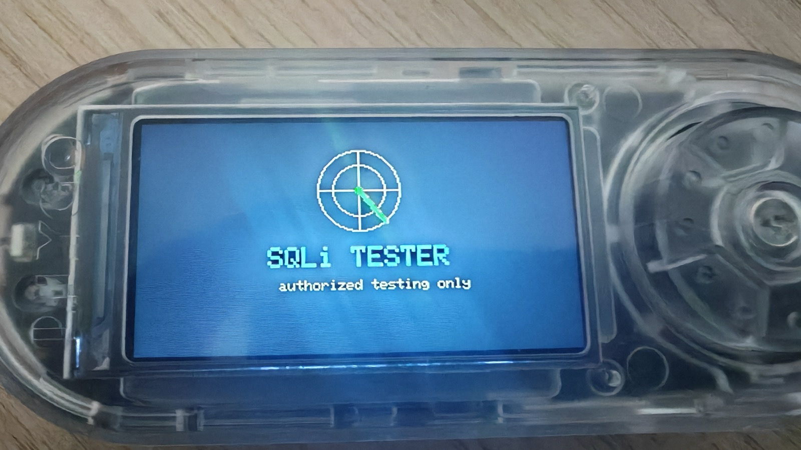
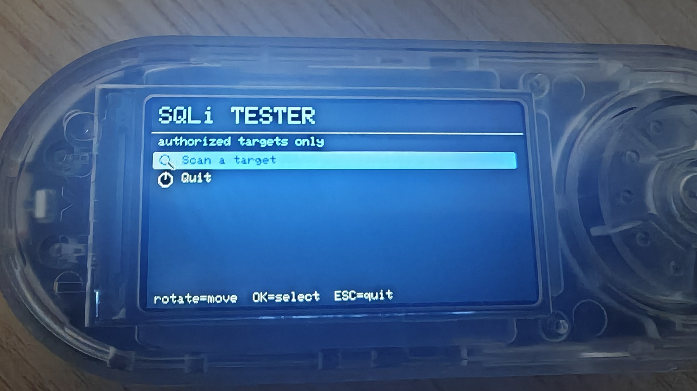
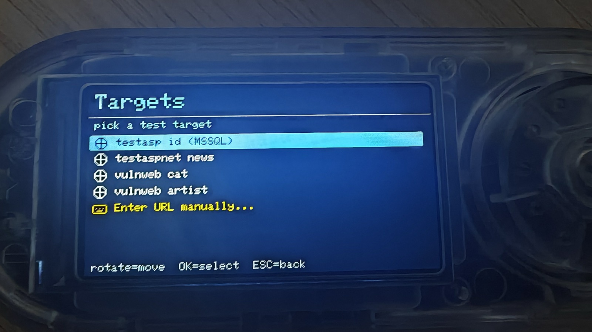
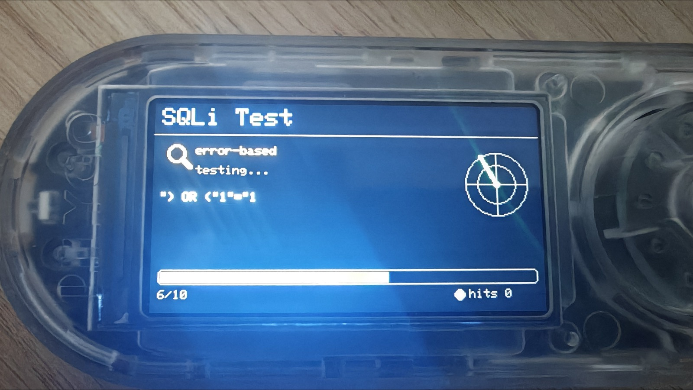
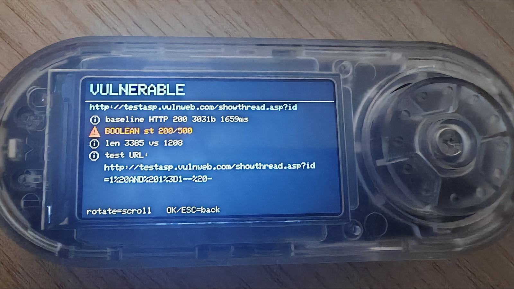
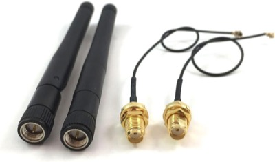

# 💉 SQLi Tester — Bruce / LilyGO T-Embed CC1101

<p align="center">🇺🇸 <a href="README.md">English</a> · 🇫🇷 <b>Français</b></p>

[](https://github.com/BruceDevices/firmware) [](https://github.com/BruceDevices/firmware) [-F7DF1E)](https://github.com/BruceDevices/firmware) [](LICENSE)

Un petit **testeur d'injection SQL** pour l'interpréteur JS de Bruce. Vise une URL avec un paramètre, et il lance des tests **error-based**, **time-based (aveugle)** et **boolean-based** par rapport à une réponse de référence — depuis l'appareil, avec une interface à pictogrammes. Les cibles sont lues depuis un fichier `sqli_targets.txt` éditable.



## ⚠️ Légal

**Pour du test de sécurité autorisé uniquement.** À utiliser exclusivement sur **tes propres** serveurs ou des cibles pour lesquelles tu as une **autorisation écrite explicite** (les hôtes `testphp/testasp.vulnweb.com` fournis sont des sites d'entraînement publics volontairement vulnérables). Tester un système sans autorisation est illégal.

## ✨ Fonctions

- 🎯 **Menu des cibles depuis un fichier** — choisis une cible directement dans `sqli_targets.txt` (libellé + URL), ou tapes-en une à la main. Pas de longue saisie sur l'appareil.
- 🔎 **3 méthodes de détection**, comparées à une requête de référence propre :
  - **error-based** — une chaîne d'erreur de base de données apparaît alors qu'elle n'était pas dans la référence
  - **time-based (aveugle)** — une charge `SLEEP()/WAITFOR` rend la réponse ~3 s plus lente
  - **boolean-based** — `AND 1=1` et `AND 1=2` donnent des réponses nettement différentes
- 🔗 **URL de test exacte dans le rapport** — chaque détection affiche la requête précise (encodée) qui l'a déclenchée, prête à être rejouée dans un navigateur ou avec `curl`.
- 🎨 **Interface à pictos** — écran de scan animé (loupe + radar + progression + compteur de détections en direct), rapport défilant sans scintillement.

| Menu | Cibles | Scan | Résultat |
|---|---|---|---|
|  |  |  |  |

## 🚀 Installation

1. Copie **`SQL Injection.js`** et **`sqli_targets.txt`** sur la carte SD (par ex. dans `/scripts`, ou à la racine de la SD pour le fichier de cibles).
2. Sur l'appareil : **JS Interpreter → sélectionne `SQL Injection.js`** (ou ajoute-le à tes favoris avec [bruce-launcher](https://github.com/koua29/bruce-launcher)).
3. **Molette** = se déplacer, **clic** = choisir/scanner, **appui long (ESC)** ou **clic** = retour.

**Ajouter tes propres cibles** — il suffit d'éditer `sqli_targets.txt`, une par ligne :
```
libellé | http://hote/page.php?id=1
```
La charge est ajoutée à la **fin** de l'URL : termine-la donc sur la **valeur du paramètre** à tester. Si le fichier est absent, trois cibles de démo intégrées sont utilisées.

## 🛠️ Comment ça marche

L'interpréteur JS de Bruce n'expose **aucun socket TCP brut** ni **`encodeURIComponent`** — seulement `wifi.httpFetch()`. L'outil encode donc les charges à la main, envoie des requêtes HTTP simples, et compare chaque réponse à la référence (code de statut, taille du corps, temps de réponse et signatures d'erreurs de base de données).

## ⚠️ Limites

- Les cibles **HTTPS/TLS** sont sondées en HTTP simple et ne peuvent généralement pas être lues de façon fiable.
- Les sites d'entraînement publics `vulnweb.com` sont souvent indisponibles — *« baseline request failed / connection refused »* signifie en général que **le site est en panne**, pas un bug. Essaie-en un autre, ou héberge ton propre labo (DVWA, SQLi-Labs, bWAPP) en HTTP pour t'entraîner de façon fiable.
- C'est un **détecteur de premier niveau**, pas un outil d'exploitation complet. Confirme les résultats avec un vrai outil, sur une cible autorisée.

## 🛒 Matériel

*Liens partenaires Amazon : si vous achetez via ces liens, le projet touche une petite commission, sans surcoût pour vous.*

<table>
<tr>
<td align="center" width="33%">
  <a href="https://www.amazon.fr/dp/B0D45MSMJR?linkCode=ll2&amp;tag=koua29bsqlitester-21&amp;ref_=as_li_ss_tl"></a><br>
  <b><a href="https://www.amazon.fr/dp/B0D45MSMJR?linkCode=ll2&amp;tag=koua29bsqlitester-21&amp;ref_=as_li_ss_tl">Batterie Anker 545 (10 000 mAh)</a></b><br><sub>Pour faire tourner le T-Embed loin d'une prise</sub>
</td>
<td align="center" width="33%">
  <a href="https://www.amazon.fr/dp/B0C1FCZM94?linkCode=ll2&amp;tag=koua29bsqlitester-21&amp;ref_=as_li_ss_tl"></a><br>
  <b><a href="https://www.amazon.fr/dp/B0C1FCZM94?linkCode=ll2&amp;tag=koua29bsqlitester-21&amp;ref_=as_li_ss_tl">Antenne SMA 433 MHz (lot de 2)</a></b><br><sub>Antenne sub-GHz pour la radio CC1101</sub>
</td>
<td align="center" width="33%">
  <a href="https://www.amazon.fr/dp/B0B7NVMBPL?linkCode=ll2&amp;tag=koua29bsqlitester-21&amp;ref_=as_li_ss_tl"></a><br>
  <b><a href="https://www.amazon.fr/dp/B0B7NVMBPL?linkCode=ll2&amp;tag=koua29bsqlitester-21&amp;ref_=as_li_ss_tl">microSD SanDisk 64 Go (lot de 2)</a></b><br><sub>Pour les thèmes, scripts et captures Bruce</sub>
</td>
</tr>
</table>

<sub>En tant que Partenaire Amazon, je réalise un bénéfice sur les achats remplissant les conditions requises.</sub>

## 🙏 Crédits & licence

- Script : **koua29**. Tourne sur l'excellent **[Bruce firmware](https://github.com/BruceDevices/firmware)**.
- Publié sous **licence MIT** — voir [LICENSE](LICENSE).

## ☕ Un café ?


